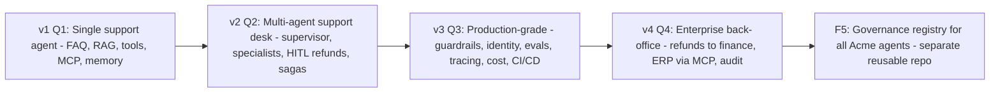

# Acme Support Platform: one running use-case across the year

## Verdict on the idea
Take it up, but as the **spine** of the existing work, not as extra work on top of it. It closes three gaps in the current roadmap:
- **The 52 patterns are standalone.** A reader learns ReAct or Saga in isolation and never sees how the pieces fit into one system, and seeing that is the core skill of an architect.
- **The 5 flagships are 5 unrelated systems** (support, multi-agent, finance, ERP, governance). Each quarter starts from zero.
- **There is no entry path for newcomers.** Content strategy and the calendar assume the reader already knows what an agent is.

The cost stays low: each week adds one "Apply it to Acme" stage (a 50 to 150 line diff plus one blog section) on top of the pattern you already produce. The 8 hour a week budget holds.

## The storyline
Acme Manufacturing (fictional) sells products online. Its support system grows over four releases, and these releases replace flagships 1 to 4:

Examples of stages, one per week:
- w01 Augmented LLM: answer FAQs with naive retrieval over policy docs and a prompt contract.
- w03 Routing: route tickets by intent and send simple ones to a cheap model.
- w07 ReAct and w10 Tool calling: the agent looks up order status.
- w11 MCP: expose Acme's orders and CRM as MCP servers.
- w12 Agentic RAG: upgrade from naive retrieval.
- w13 Memory: add customer history. This closes v1.
- w15 to w17: specialist agents for billing, returns and tech, with a supervisor and handoff to humans.
- w22 Saga: refund plus reship, with compensation if a step fails.
- w24 HITL: refunds above a threshold need approval.
- w28 Prompt-injection defence: handle a malicious customer email.
- w41 to w45: replacement-part procurement, refund reconciliation and ERP via MCP.

## Repo mechanics
- Use one evolving repo, `acme-agentic-support`. Build it in the hub under `projects/acme-support/` during Q1, then split it out at Week 13 as the existing split rule says.
- Tag every stage as `stage-w01`, `stage-w02` and so on, plus releases `v1` to `v4`. A reader can `git checkout stage-w07` and run that exact step in mock mode. Keep a `STAGES.md` changelog with one line per week.
- Keep the small, isolated sample in `patterns/wNN-slug/code/` for readers who only want the pattern. The Acme stage is the "in context" version.
- In [docs/roadmap/05-repo-strategy.md](docs/roadmap/05-repo-strategy.md), replace the split rows for flagships 1 to 4 with the single Acme repo and its quarterly releases. `agent-governance-registry` stays separate, because it is reusable tooling with a different lifecycle.

## Additions that help newcomers (none of these are in the roadmap today)
1. **Start Here page** on the site. It gives a short primer (tokens, context window, embeddings, structured output, the difference between an agent and a workflow), the Acme storyline, and the four-level ladder below. Write it once in Week 1.
2. **Level tag on every post:** Foundation (Q1), Practitioner (Q2), Production (Q3), Architect (Q4). Add a "prerequisites" line that links earlier weeks.
3. **Architect's notebook box in every blog post:** the decision, the rejected alternative, the main failure mode, the cost per 1,000 runs, and the non-functional requirements it affects. This is the habit that turns readers into architects. It reuses `adr.md`, so it adds little work.
4. **AI Architect skills map:** a competency matrix (design, RAG and data, orchestration, security and identity, evals and observability, cost, governance) that maps each skill to its weeks and to the framework's 12 pillars in [framework/README.md](framework/README.md). It doubles as a second newsletter lead magnet.
5. **Pattern Radar, once a month and public:** turn the existing Friday ResearchScout digest into a short post on what's new and where it would plug into Acme. This handles latest patterns without disturbing the evergreen spine.
6. **Quarterly design challenge** in the four buffer weeks: post an Acme scenario ("design the returns flow for 10x volume"), collect reader answers, and publish your own answer in the retrospective. This drives engagement at no cost and uses weeks you already have.

## Calendar swaps for recent patterns missing from the calendar
These swaps keep the count at 52 weeks:
- **w09:** merge Reflection into w06 Evaluator-optimizer (they overlap). w09 becomes **"Agent or workflow? A decision framework"**, the first real architect lesson.
- **w19:** replace Debate/consensus, which is niche for enterprises, with **Long-running background agents**: case agents that work for days and resume, set next to w23 Durable execution.
- **w49:** Approval workflows overlaps with w24 HITL. Replace it with **Computer-use agents for legacy back-office screens**, a real ERP need.
- **Voice and realtime support agents:** cover them as a Pattern Radar feature first. Promote them to a full week only if reader demand shows up.

## Files to change
- [content/calendar.md](content/calendar.md): add **Acme stage** and **Level** columns, apply the three swaps, and rename the flagship labels to Acme v1 to v4 plus F5.
- New file `docs/roadmap/07-running-use-case.md`: the storyline, the stage-by-week map, tag conventions, and the "Apply it to Acme" rules (stage must be small, runnable in mock mode, synthetic data only).
- [docs/roadmap/01-year1-learning-plan.md](docs/roadmap/01-year1-learning-plan.md) and [docs/roadmap/02-content-strategy.md](docs/roadmap/02-content-strategy.md): the flagship table becomes Acme releases, and add the level ladder, Pattern Radar, design challenges and skills map.
- [docs/roadmap/05-repo-strategy.md](docs/roadmap/05-repo-strategy.md): the single Acme repo and its tags.
- [hermes/templates/blog.md](hermes/templates/blog.md): add `level` and `acmeStage` front-matter fields, plus "Prerequisites", "Apply it to Acme" and "Architect's notebook" sections.
- [hermes/skills/code-builder/SKILL.md](hermes/skills/code-builder/SKILL.md), [hermes/skills/blog-writer/SKILL.md](hermes/skills/blog-writer/SKILL.md) and [hermes/skills/weekly-pack/SKILL.md](hermes/skills/weekly-pack/SKILL.md): the Acme stage diff and its section become part of the weekly pack. [hermes/skills/research-scout/SKILL.md](hermes/skills/research-scout/SKILL.md) produces the monthly Radar.
- Retrofit Week 1: add the Acme stage 1 section to [patterns/w01-augmented-llm/blog.md](patterns/w01-augmented-llm/blog.md) and create `projects/acme-support/` at `stage-w01`.
- Site: add a `start-here` page in `site/src/pages/` and link it from `index.astro`.
