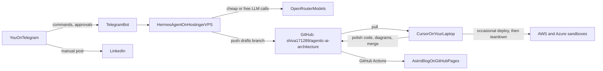
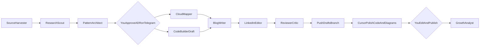

---
name: Agentic Architecture Content Engine
overview: Refine roadmap.md into an executable Year 1 plan built around a weekly "Agentic Architecture Pattern of the Week" (blog + LinkedIn posts + runnable Python sample + AWS and Azure mappings + diagram). The content is produced by a team of Hermes Agent skills hosted on a Hostinger VPS, controlled from Telegram, and run on free or cheap models within a $10/month AI budget. Cursor credits are used for code and diagram polish. Year 1 is learning in public: building skills, LinkedIn reach and industry standing that also strengthen your day job as an architect. Monetization stays an optional, later track.
todos:
  - id: guardrails
    content: "Week 0: Adopt the learning-in-public ground rules (no employer use cases/code/data, synthetic examples, personal-views disclaimer); create OpenRouter, Telegram bot, AWS and Azure free accounts with budget alerts"
    status: pending
  - id: vps-setup
    content: "Provision Hostinger KVM VPS (Ubuntu 24.04), harden it (non-root user, SSH keys, ufw, fail2ban, swap)"
    status: pending
  - id: hermes-install
    content: Install Hermes Agent on VPS, configure OpenRouter + free/cheap model tiers, set spend cap, run as systemd service
    status: pending
  - id: telegram-gateway
    content: Create Telegram bot via BotFather, connect Hermes gateway, restrict to your Telegram user ID, test commands
    status: pending
  - id: refine-roadmap
    content: "Restructure roadmap: slim roadmap.md (vision + 5-year phases + links) and split into docs/roadmap/ (year-1 plan, content strategy, multi-cloud, agent ops + budget, ground rules, future monetization)"
    status: pending
  - id: repo-scaffold
    content: "Init local git, add remote git@github.com:shiva171289/agentic-ai-architecture.git, scaffold hub repo (docs/, content/, patterns/, framework/, site/, hermes/, infra/, .github/), add LICENSE (MIT code, CC BY 4.0 content), push main"
    status: pending
  - id: content-calendar
    content: Write content/calendar.md with the 52-week pattern list (each with AWS and Azure mapping) mapped to 5 flagship projects, plus voice-guide.md (metrics.md lives in the private repo)
    status: pending
  - id: hermes-skills
    content: Author Hermes SKILL.md files (SourceHarvester, Scout, Architect, CloudMapper, CodeBuilder, Diagram, BlogWriter, LinkedInEditor, Critic, GrowthAnalyst) + verified-sources allowlist + harvest script + weekly-pack orchestrator + cron schedules + git branch workflow
    status: pending
  - id: templates
    content: "Create templates: brief.md, adr.md, cloud-mapping.md, blog.md, linkedin.md, sample code skeleton (uv, pytest, mock LLM mode, aws/ and azure/ adapters)"
    status: pending
  - id: site
    content: Set up Astro blog in site/ rendering patterns/*/blog.md with RSS and newsletter signup; deploy free via GitHub Actions to GitHub Pages
    status: pending
  - id: week1-pilot
    content: Run pilot Week 1 (Augmented LLM) end-to-end from Telegram through Hermes, polish in Cursor, measure token cost, tune model tiers
    status: pending
  - id: community-assets
    content: "Create public community assets: Production Readiness Checklist (newsletter magnet), framework v0.1, About page with personal-views disclaimer; create private repo agentic-ai-private for metrics, contacts and future offer drafts"
    status: pending
  - id: split-repos
    content: "Per repo strategy: split flagship projects into their own public repos at the end of each quarter, and extract hermes-content-factory once skills are stable (around Month 3)"
    status: pending
isProject: false
---

# Agentic Architecture Content Engine (Year 1)

## Goal
In 12 months: ship about 48 architecture patterns, roughly 100 LinkedIn posts and 5 flagship reference projects, all as **learning material**. Each pattern is shown cloud-agnostic first, then mapped to **AWS** and **Azure** AI services. This builds deep skills and a following among architects and technology leaders, and it feeds straight back into your day job. Any paid work is a later, optional step (see Step 10). Hermes agents (on a Hostinger VPS, driven from Telegram) do the research and drafting. Cursor does the heavier code and diagram polish. You decide the architecture and publish in your own voice.

## Architecture of the setup



## Budget (monthly)
- **AI models: $10.** OpenRouter credits, used mostly on free and very cheap models (tiers below).
- **Hostinger VPS: about $5 to $7** (KVM 1 or KVM 2 plan, billed yearly). This is separate from the $10. If the $10 has to cover the VPS too, see "Is $10 enough?".
- **Cloud sandboxes: $0 to $5.** Use the AWS Free Tier and Azure free account credits, and always tear down after a demo. Budget alerts are mandatory.
- **Cursor: your existing plan credits**, for code, diagrams and final ADR review.
- Blog hosting (GitHub Pages) and the newsletter (Buttondown free tier) cost nothing.

### Model tiers (via OpenRouter, one API key)
- **Tier 0, free.** Research digests, summaries, first drafts and LinkedIn variants. Use OpenRouter `:free` models such as DeepSeek V3/R1 free, Qwen3 (and Qwen3 Coder) free, GLM free, Llama 3.3 70B free, or Gemini Flash free. Free model names change often, so recheck the list each month. Once you have bought at least $10 of credits, OpenRouter's free-model limit rises from about 50 to about 1,000 requests a day. That makes the $10 doubly useful.
- **Tier 1, cheap paid (about $0.1 to $1 per million tokens).** Use for anything that needs reliable tool calling: the orchestrator, PatternArchitect, ReviewerCritic and CloudMapper. Candidates are DeepSeek V3.x, Qwen3 235B, GLM 4.x, Kimi K2, MiniMax M2 or Gemini Flash. Pick whichever handles Hermes tool calls reliably in the Week 1 pilot.
- **Tier 2, premium (Cursor).** Use Claude or GPT-class models inside Cursor for sample-code quality, Mermaid and draw.io diagrams, and a final architecture sanity check. These calls are covered by Cursor credits, not the $10.
- **Fallback rule:** if a free model is rate-limited or fails, fall back to Tier 1. Never fall back automatically to a premium model on OpenRouter.

### Is $10 enough?
Yes, to start. A weekly pack is roughly 1 to 3 million tokens, mostly on free models. The paid share should come to about $1 to $2 a week, so $10 covers a month with some room for experiments. It becomes tight in three cases: you route long-form writing to premium models, you run research cron jobs daily, or the $10 must also cover the VPS. Upgrade path:
- **At $20 a month:** a Tier 1 model for all drafting, which improves quality.
- **At $40 to $50 a month:** a premium model on OpenRouter for the ADR and blog steps, which means less Cursor usage.

Increase spending only when you choose to, for example once sponsorship, speaking fees or paid work comes in. Log weekly spend in the private repo's `metrics.md`.

---

## Step 0 (Week 0): Learning-in-public ground rules and accounts
Year 1 is framed as **learning in public**. There are no employer use cases and no paid client work, so a moonlighting review isn't a blocker. These rules keep it clean. They go into `docs/roadmap/00-ground-rules.md` and are added to every agent's skill file as a hard constraint:
1. **No employer material, ever:** no code, architecture, documents, customer names, internal tools or problems you have only seen at work. Every example uses fictional companies (for example "Acme Manufacturing") and synthetic or public data.
2. **Generic patterns only.** Write about industry-standard patterns and public vendor services. Do not write "how we did X at my company".
3. **Disclaimer** on the blog's About page and in your LinkedIn About section: "Views and examples are my own, for learning purposes, and do not represent my employer."
4. **Personal resources only:** personal laptop time, personal GitHub (`shiva171289`), personal cloud accounts and personal email. Never use work devices or work hours.
5. **Licensing:** MIT for code and CC BY 4.0 for written content, so it is clearly public learning material.
6. **Before any future paid work** (Year 2 or later), quickly re-read the moonlighting and IP clauses, or ask HR. Only then switch on Step 10's optional track.
7. Agents never post to LinkedIn. You publish manually, because of LinkedIn's terms and because your own voice is the brand.

Accounts:
1. Create OpenRouter (buy $10 of credits and set a key limit of $10 a month), Telegram, AWS Free Tier and an Azure free account.
2. Set an **AWS Budget** ($5 with email alert) and an **Azure Cost Management budget** ($5 with alert) before creating any resources.

## Step 1: Hostinger VPS setup (step by step)
1. In Hostinger, buy **VPS KVM 1** (1 vCPU, 4 GB RAM) or **KVM 2** if you want headroom. Choose the plain **Ubuntu 24.04** OS template and a nearby data centre, such as India or Singapore.
2. In hPanel, open VPS, then Settings, then SSH keys, and add your public key. If you don't have one, generate it on Windows with `ssh-keygen -t ed25519`.
3. SSH in as root: `ssh root@<vps-ip>`.
4. Create a non-root user:
   - `adduser hermes && usermod -aG sudo hermes`
   - `rsync -a ~/.ssh /home/hermes/ && chown -R hermes:hermes /home/hermes/.ssh`
5. Harden the server:
   - `apt update && apt upgrade -y && apt install -y ufw fail2ban git curl unattended-upgrades`
   - `ufw allow OpenSSH && ufw enable`. No other inbound ports are needed, because the Telegram gateway makes outbound connections only.
   - In `/etc/ssh/sshd_config`, set `PermitRootLogin no` and `PasswordAuthentication no`, then run `systemctl restart ssh`.
6. Add 2 GB of swap (useful on 4 GB RAM):
   - `fallocate -l 2G /swapfile && chmod 600 /swapfile && mkswap /swapfile && swapon /swapfile`
   - `echo '/swapfile none swap sw 0 0' >> /etc/fstab`
7. Log in again as `hermes` and confirm the following steps work without root.

## Step 2: Install and configure Hermes Agent (step by step)
Commands follow the Nous Research `hermes-agent` README. Confirm them against the current README before running.
1. Install: `curl -fsSL https://raw.githubusercontent.com/NousResearch/hermes-agent/main/scripts/install.sh | bash`, then `source ~/.bashrc`.
2. Run `hermes setup` (or `hermes model`). Choose **OpenRouter**, paste the API key, and set the default model to your Tier 1 pick. Keys are stored in `~/.hermes/.env`, so run `chmod 600` on it.
3. Configure the cheap-first model routing in `~/.hermes/config.yaml`: Tier 1 as the main model, a Tier 0 free model for auxiliary, summarization and subagent tasks, and a Tier 1 fallback. Disable or limit any expensive vision or web tools you don't need.
4. Give Hermes access to the repo:
   - `ssh-keygen -t ed25519 -f ~/.ssh/gh_deploy`
   - On GitHub, open `shiva171289/agentic-ai-architecture`, then Settings, then Deploy keys, then Add key. Paste `~/.ssh/gh_deploy.pub` and tick **Allow write access**. This key is for this repo only, not your account key.
   - Add this to `~/.ssh/config`: `Host github.com` / `IdentityFile ~/.ssh/gh_deploy` / `IdentitiesOnly yes`
   - `git clone git@github.com:shiva171289/agentic-ai-architecture.git ~/work/agentic-ai-architecture`
   - Set the identity: `git config user.name "Hermes (drafts)"` and `git config user.email "<your-github-noreply-email>"`.
   - In GitHub, open Settings, then Branches, and protect `main` by requiring a pull request. Hermes can only push to `drafts/*` branches, and you merge from Cursor or GitHub.
5. Point Hermes at the skills folder: symlink or copy `hermes/skills/*` from the repo into `~/.hermes/skills/`. A `git pull` cron job keeps them in sync.
6. Test from the CLI with `hermes`, then ask "list your skills" and "summarize roadmap.md in the repo".

## Step 3: Telegram as the control channel (step by step)
1. In Telegram, open **@BotFather**, send `/newbot`, choose a name (for example "ArchFactory") and a username ending in `bot`. Copy the token.
2. Get your numeric user ID from **@userinfobot**.
3. On the VPS, run `hermes gateway setup`. Choose Telegram, paste the token, and set **allowed users** to your user ID only. This step is critical: otherwise anyone who finds the bot can spend your credits.
4. Install the gateway as a service so it survives reboots: `hermes gateway install`, or create a systemd user service, then run `loginctl enable-linger hermes`.
5. Optionally, register commands in BotFather with `/setcommands`: `sources`, `brief`, `pack`, `status`, `cost`, `post`, `digest`.
6. Test by sending "status" to the bot from your phone. You should get a reply from the VPS.

### Telegram interaction model
- `brief w05 orchestrator-workers`: runs SourceHarvester (if corpus stale), then ResearchScout, and replies with the summary and three angles.
- `pack w05`: runs the full weekly pack and pushes the `drafts/w05` branch, then replies with a checklist and links.
- `adr w05 approve` or `adr w05 revise: <notes>`: your approval gate.
- `sources refresh` or `sources w05`: runs SourceHarvester and updates `content/source-corpus/latest.md`.
- `post w05 A`: returns LinkedIn Post A as plain text, ready to paste.
- `cost`: shows OpenRouter spend this week and month (via the OpenRouter credits API).
- Cron results (Friday research digest and Monday analytics nudge) arrive in Telegram automatically.

---

## Step 4: Restructure the roadmap
The current [roadmap.md](roadmap.md) is one 870-line file that mixes vision, income targets, the Year 1 plan and Years 2 to 5. Split it so the root file is a one-page overview and the details live in focused docs:

```text
roadmap.md                          # one page: why, positioning, 5-year phases, links below
docs/roadmap/
  00-ground-rules.md                # learning in public, no employer material, disclaimer, licensing
  01-year1-learning-plan.md         # skills by quarter, certifications, 5 flagship projects, milestones
  02-content-strategy.md            # weekly cadence, LinkedIn formats, blog, newsletter, KPIs
  03-multi-cloud-aws-azure.md       # service map (Step 5), sandbox rules, IaC conventions
  04-agent-operations.md            # Hermes on Hostinger, Telegram, model tiers, $10 budget, upgrade path
  05-repo-strategy.md               # hub repo + when to create new repos (Step 6)
  06-future-monetization.md         # existing Years 2-5 content (consulting, training, products, SaaS, income targets), marked optional
```

Content changes while splitting:
- **Positioning:** change to "Enterprise Agentic AI Architect | AWS and Azure | Learning in public". Agentic ERP becomes the Q4 deep-dive niche.
- **Year 1 goal:** change from "₹2 to 5 lakh" to skills, audience and a portfolio. Income targets move to `06-future-monetization.md` as an optional Year 2+ track.
- **Day-job link:** add a section on how this helps your current role. You get faster evaluation of AI patterns at work, an AWS and Azure comparison you can reuse in design reviews, stronger standing as an architect, and the certifications.
- **Time budget:** about 8 hours a week, keeping the "What to avoid" list.
- **Code stack:** Python, cloud-agnostic core (LangGraph, OpenAI Agents SDK, Pydantic AI, MCP), with thin `aws/` (Strands Agents, Bedrock) and `azure/` (Microsoft Agent Framework, Azure AI Foundry) adapters.
- **Certifications:** one per cloud, an AWS GenAI or ML track and an Azure AI Engineer track. Check the current catalogs.

## Step 5: AWS and Azure service map (used in every pattern's `cloud-mapping.md`)
- **Models:** Amazon Bedrock, compared with Azure OpenAI and Foundry Models.
- **Managed agent runtime:** Bedrock AgentCore (Runtime, Memory, Gateway, Identity, Observability) and Bedrock Agents, compared with Azure AI Foundry Agent Service.
- **Agent SDKs:** Strands Agents, compared with Microsoft Agent Framework (successor to Semantic Kernel and AutoGen).
- **RAG:** Bedrock Knowledge Bases and OpenSearch Serverless, compared with Azure AI Search.
- **Guardrails and safety:** Bedrock Guardrails, compared with Azure AI Content Safety and Prompt Shields.
- **Orchestration and events:** Step Functions, EventBridge and SQS, compared with Durable Functions, Logic Apps, Event Grid and Service Bus.
- **Identity:** IAM, Cognito and AgentCore Identity, compared with Entra ID (including Entra Agent ID) and managed identities.
- **MCP and tools:** AgentCore Gateway and Lambda tools, compared with Azure API Management as an MCP gateway and Azure Functions.
- **Observability and evals:** CloudWatch, X-Ray and AgentCore Observability, compared with Application Insights and Foundry evaluations and tracing.
- **Infrastructure as code:** Terraform for AWS and Bicep for Azure, both in `infra/`. Every deploy has a matching `destroy` step.

Service names change quickly. CloudMapper checks current docs each week and flags anything renamed or deprecated.

## Step 6: Repositories

### Hub repo: `git@github.com:shiva171289/agentic-ai-architecture.git` (public)
This repo holds the roadmap, the content factory, every weekly pattern with its small sample, the framework and the blog.

```text
agentic-ai-architecture/
  README.md  LICENSE (MIT)  LICENSE-content (CC BY 4.0)  roadmap.md
  docs/roadmap/          # restructured roadmap (Step 4)
  content/  calendar.md  voice-guide.md
  patterns/wNN-slug/
    brief.md  adr.md  cloud-mapping.md  diagram.mmd  blog.md  linkedin.md
    code/  core/  aws/  azure/  tests/  README.md
  framework/             # Enterprise Agentic AI Architecture Framework (12 pillars)
  infra/templates/       # shared Terraform (AWS) and Bicep (Azure) modules
  site/                  # Astro blog -> GitHub Pages via .github/workflows/deploy.yml
  hermes/                # skills/, sources/verified-sources.json, tools/harvest_sources.py, templates/, cron.md
  content/source-corpus/ # RSS snapshots (latest.md) for grounding
  .github/workflows/     # site deploy + pytest on patterns/**/code
```

First-time setup from your laptop (Windows PowerShell, in `d:\projects\agentic-ai-architecture`). This uses your existing **personal** SSH key (`~/.ssh/id_ed25519_personal`) through the `github.com-personal` host alias:
1. `git init -b main`
2. Set a **repo-local personal identity**. Your global `user.email` is your work address (`shivashanmugam.mohan@iris.co.uk`), so without this, commits would be stamped with your work email:
   - `git config user.name "Shivashanmugam Mohan"`
   - `git config user.email "shiva17121989@gmail.com"`, or your GitHub noreply address `<id>+shiva171289@users.noreply.github.com` to keep your email private.
3. `git remote add origin git@github.com-personal:shiva171289/agentic-ai-architecture.git`. The explicit alias is the clearest option. Plain `git@github.com:` also works, because your global `insteadOf` rewrites it to `github.com-personal`.
4. Check the setup:
   - `ssh -T git@github.com-personal` should print "Hi shiva171289!"
   - `git config user.email` should show the personal address.
5. Add the scaffold, then `git add .`, `git commit -m "Scaffold content engine"` and `git push -u origin main`.
6. In GitHub, open Settings, then Pages, and set Source to GitHub Actions. Protect `main` (see Step 2).
7. Use the same steps (alias plus repo-local identity) for `agentic-ai-private` and every split-out repo. Optionally, add an `includeIf "gitdir/i:D:/projects/"` block to your global config that loads a personal `.gitconfig-personal`, so every repo under `D:\projects` gets the personal identity automatically.

### Private repo: `shiva171289/agentic-ai-private` (create in Month 1)
This holds anything that shouldn't be public: `metrics.md` (follower and spend numbers), `contacts.md` (people you're engaging), draft opinions, and later, any offer or SOW drafts. Hermes gets a second deploy key for this repo only if GrowthAnalyst needs it.

### When to create a new repo
Weekly pattern samples stay in the hub under `patterns/`. They are small and teaching-sized, and keeping them together builds one strong, starred repo. Create a new public repo when any of these is true:
- It is a **flagship project** with multiple services, its own infrastructure and deploy/destroy steps, or more than about 1,500 lines of code.
- It is something people will **clone and run on its own** and would star separately, such as a demo you link from a LinkedIn post.
- It has a **different lifecycle** from the weekly content, such as reusable tooling.

Planned split-outs (each linked from the hub README and its pattern pages):
- **End of Q1 (Week 13):** `agentic-customer-support-reference`, Flagship 1.
- **Around Month 3:** `hermes-content-factory`, your agent team's skills and setup. Once stable it is a strong portfolio piece and a post of its own: "How I run a multi-agent content team for $10 a month".
- **End of Q2 (Week 26):** `multi-agent-enterprise-reference`, Flagship 2.
- **End of Q3 (Week 39):** `agentic-finance-workflow-reference`, Flagship 3.
- **Q4:** `agentic-erp-reference-architecture`, Flagship 4.
- **Q4:** `agent-governance-registry`, Flagship 5 (the seed for a possible future product).
- Optional, once there are 20 or more patterns: `agentic-patterns-python`, a cleaned-up, pip-installable catalog of the pattern samples.

Each flagship repo follows the same template: README with diagram, `docs/adr/`, `src/`, `infra/aws` (Terraform) and `infra/azure` (Bicep), `make deploy-aws`, `make deploy-azure` and `make destroy`, a mock mode, CI, and an MIT license.

## Step 7: The Hermes agent team



Each role is a Hermes skill in `hermes/skills/<role>/SKILL.md`. A `weekly-pack` skill orchestrates them through subagent delegation.
- **SourceHarvester** (no LLM; cron Thursday 6:30 am IST): runs `hermes/tools/harvest_sources.py` against allowlisted RSS (AWS, Azure, Microsoft DevBlogs, OpenAI, Anthropic, Google Cloud AI, LangChain). Writes `content/source-corpus/latest.md`.
- **ResearchScout** (Tier 0; cron Friday 7 am IST): reads the corpus plus arXiv/OSS releases. Writes `brief.md` with citations — no uncited vendor claims.
- **PatternArchitect** (Tier 1): drafts `adr.md`, covering the problem, options, when not to use the pattern, failure modes, cost and latency, and security. Then it waits for your approval on Telegram.
- **CloudMapper** (Tier 1): writes `cloud-mapping.md`. It covers the AWS and Azure implementations, a service comparison, an indicative cost per 1,000 runs, and lock-in notes.
- **CodeBuilder** (Tier 0 or 1 draft): creates a minimal skeleton in `code/` with a cloud-agnostic core, aws and azure adapters, a mock LLM mode so it runs with no keys, and pytest tests. Final polish happens in Cursor.
- **DiagramAgent** (Tier 0): writes Mermaid drafts for three views (logical, AWS deployment and Azure deployment) plus a carousel outline. You finish them in Cursor and export PNG/SVG.
- **BlogWriter** (Tier 0, Tier 1 for the final pass): writes a 1,200 to 1,800 word `blog.md` following `voice-guide.md`.
- **LinkedInEditor** (Tier 0): writes Post A (the pattern plus a diagram), Post B (an opinion piece, such as "AWS vs Azure for X" or "when NOT to use X"), and 3 comment starters.
- **ReviewerCritic** (Tier 1): fact-checks against the corpus, `brief.md` sources, and official doc roots in `verified-sources.json`; rejects allowlist violations and removes hype.
- **GrowthAnalyst** (Tier 0; cron Monday 8 am IST): reads the private `metrics.md` and proposes next week's angle and who to engage with.

Every skill includes the Step 0 ground rules. ReviewerCritic also rejects any draft that looks employer-specific, such as real company names, internal tool names or "at my company" phrasing.

Hermes memory stores your voice, topics already covered and the formats that performed best.

### Cursor's role (premium quality, paid by Cursor credits)
- Pull `drafts/wNN`, then ask Cursor to make the sample production-quality, run the tests, and check the aws and azure adapters.
- Turn the Mermaid drafts into polished diagrams (Mermaid, draw.io or Excalidraw), export them, and build the carousel slides.
- Do a final architecture review of `adr.md` and `cloud-mapping.md`, then merge to `main`. GitHub Actions deploys the blog.

## Step 8: Weekly rhythm (about 8 hours)
- **Friday (agents):** the research brief arrives on Telegram. Reply with `pack wNN` or redirect the angle.
- **Saturday (you, 2.5 h):** approve the ADR on Telegram, then polish the code and diagrams in Cursor.
- **Sunday (you, 1.5 h):** edit the blog into your own voice, merge, and the site publishes. Spend another hour on networking: replying to DMs, following up with architects and leaders you've met, and updating the private `contacts.md`.
- **Tuesday (30 min):** publish LinkedIn Post A with the diagram or carousel, and reply to comments within 2 hours.
- **Thursday (30 min):** publish Post B with the blog link in the first comment.
- **Daily (15 min):** leave 5 thoughtful comments on posts by target CTOs and architects.
- **Monthly sandbox day:** deploy one flagship to AWS or Azure, record a 2-minute demo, then tear it down.

## Step 9: 52-week pattern calendar (each pattern has AWS and Azure mappings)
- **Q1, Weeks 1 to 13: Single-agent foundations.** Augmented LLM, prompt chaining, routing, parallelization, orchestrator-workers, evaluator-optimizer, ReAct, plan-and-execute, reflection, tool calling, MCP servers, agentic RAG (Bedrock Knowledge Bases vs Azure AI Search), memory and context engineering (AgentCore Memory vs Foundry threads). Flagship 1: Agentic Customer Support.
- **Q2, Weeks 14 to 26: Multi-agent and orchestration.** Supervisor, hierarchical teams, handoff and swarm, blackboard, debate, A2A protocol, event-driven agents (EventBridge vs Event Grid), saga with compensation (Step Functions vs Durable Functions), durable execution, human-in-the-loop, knowledge-graph RAG (Neptune vs Cosmos DB). Flagship 2: Multi-agent Enterprise Architecture.
- **Q3, Weeks 27 to 39: Production readiness, using managed services.** Prompt-injection defence (Bedrock Guardrails vs Prompt Shields), least-privilege tools, agent identity (AgentCore Identity vs Entra Agent ID), MCP gateways (AgentCore Gateway vs APIM), evals, OpenTelemetry tracing, model routing and cost, caching, reliability, agent CI/CD, a managed-runtime showdown (AgentCore vs Foundry Agent Service). Flagship 3: Agentic Finance Workflow.
- **Q4, Weeks 40 to 52: The Agentic ERP niche and governance.** Procure-to-pay agent, finance reconciliation, inventory and planning, compliance and audit agent, ERP integration via MCP, SAP and Dynamics 365 integration angles, an agent governance registry, and a multi-cloud reference architecture. Flagships 4 and 5: Agentic ERP Reference Architecture and Agent Governance Prototype.
- Keep 4 buffer weeks, one per quarter, for a retrospective, a "Quarter in Patterns" round-up, and a cost and budget review.

## Step 10: Reach and industry standing (Year 1), with an optional monetization track
Reach plan:
- **Month 1:** Rewrite your LinkedIn headline, About section (with the disclaimer) and Featured section (hub repo plus blog). Launch the site and newsletter. Build a list of 30 or more architects, CTOs, AWS Heroes and Microsoft MVPs to learn from and engage with.
- **Month 2:** Publish framework v0.1 and the Production Readiness Checklist, which visitors get free by signing up for the newsletter.
- **Month 3:** Hold 5 conversations with practitioners about what they're struggling with, and use the answers to steer the Q2 and Q3 topics.
- **Month 4:** Make the `hermes-content-factory` repo public, along with its behind-the-scenes post.
- **Month 6:** Run a free webinar or LinkedIn Live, "AWS vs Azure for Production Agents". Submit talks to AWS and Azure community days and local meetups in Chennai and Bengaluru.
- **Months 9 to 12:** Give 1 or 2 community talks, consider applying to the AWS Community Builders or Microsoft MVP programs, and publish the "Year of Agentic Patterns" round-up.

Optional monetization track (from Month 6 at the earliest, and only after the Step 0 check of your contract):
- Watch for signals: inbound DMs asking for help, workshop requests, newsletter readers asking for deeper material.
- If the signals are strong, activate the Year 2 ideas in `06-future-monetization.md`: an architecture review, workshops, the course. Keep all offer drafts in the private repo.

## Step 11: Reviews
- **Weekly:** use the `cost` command on Telegram. If spend runs above $3 a week, push more work to Tier 0.
- **Monthly:** review KPIs and refresh the free-model list. Cut the worst-performing post format.
- **Quarterly:** refresh the skills, retire agents that aren't saving time, and re-plan the next quarter's topics from questions in comments and DMs.

## Year-end targets
48 or more patterns (all with AWS and Azure mappings), 5 flagship repos, about 100 posts, framework v1.0, 1 or 2 cloud AI certifications, 5,000 or more LinkedIn followers (adjust based on where you start), 500 or more newsletter subscribers, 1 or 2 community talks, and a hub repo with meaningful GitHub stars. All of this within the $10 to $20 AI budget, with a clear go or no-go decision on monetization for Year 2.