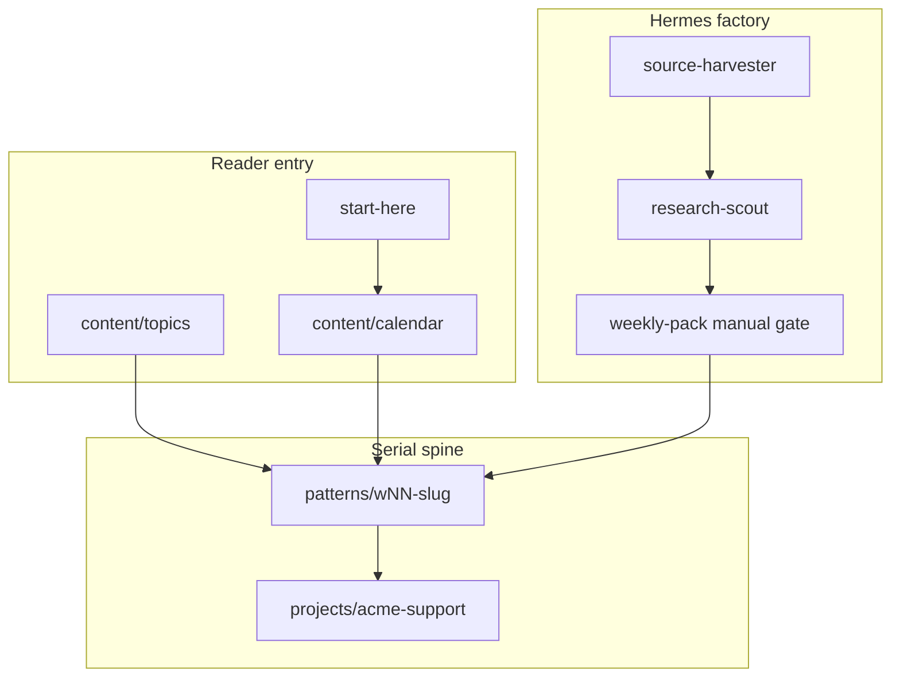
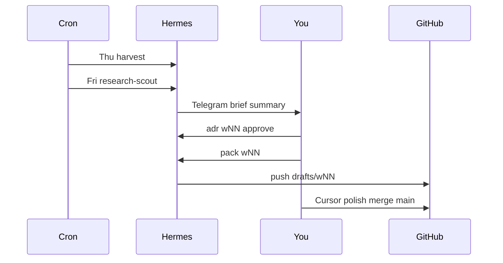

# Content structure, scenario ladders, weeks 2–4, and cron truth

## What the reference repo does well

[sample-repo/awesome-generative-ai-guide/README.md](sample-repo/awesome-generative-ai-guide/README.md) optimizes for **intent-first navigation**:

- **Journeys** (use / build / understand / interview) × **levels** (101 / 201 / 301)
- **Topic hubs** (e.g. [topics/rag.md](sample-repo/awesome-generative-ai-guide/topics/rag.md)) that cross-link courses, notebooks, and depth
- **System-design cases** with a fixed **[5-layer spine](sample-repo/awesome-generative-ai-guide/interview_prep/system-design/README.md)** (model → wrapping → evals/guardrails → production → optimization), Problem-First scoping, and **runnable code** per case ([customer-support-agent](sample-repo/awesome-generative-ai-guide/interview_prep/system-design/customer-support-agent/README.md) is essentially the same story as Acme, including hybrid retrieval assumptions)

Your hub already has stronger **time-series** structure than the guide:

| You have | Guide has |
|----------|-----------|
| [content/calendar.md](content/calendar.md) — 52-week spine + Acme stages | Open catalog, not a serial course |
| [content/start-here.md](content/start-here.md) + site Start Here | Journey grid on README |
| [projects/acme-support/](projects/acme-support/) running storyline | Isolated case studies |
| [patterns/w01-augmented-llm/](patterns/w01-augmented-llm/) weekly factory | interview_prep/system-design/* |

**Best practice to adopt:** keep the **52-week serial spine** as the flagship “Build AI” journey, and add a **topic + scenario layer** on top (guide-style browse) without duplicating the calendar.

## Why “week 2 never came” (cron reality)

From [hermes/cron.md](hermes/cron.md) and [docs/roadmap/04-agent-operations.md](docs/roadmap/04-agent-operations.md):

| Scheduled (if crontab installed) | What it does | What it does **not** do |
|-----------------------------------|--------------|-------------------------|
| Thu harvest | Corpus refresh | Write `patterns/w02-*/` |
| Fri 07:00 UTC ResearchScout | Draft `brief.md` for **next** week (skill text) | Run `pack wNN` |
| Mon GrowthAnalyst | KPI nudge | Auto-push drafts branch |
| News jobs | Inshorts pipeline | Weekly pattern pack |

**Full weekly packs are Telegram-driven:** `brief wNN` → human ADR approve → `pack wNN` ([hermes/skills/weekly-pack/SKILL.md](hermes/skills/weekly-pack/SKILL.md), [docs/setup/week1-operating-guide.md](docs/setup/week1-operating-guide.md) Day 5–7).

Likely failure modes after w01:

1. **Crontab never enabled** — [docs/setup/cron-enable.md](docs/setup/cron-enable.md) is explicitly “after Week 1 pilot”; scout digest only appears if you pasted the block on the VPS.
2. **Expectation mismatch** — original plan note: “Friday brief arrives; **you** reply `pack wNN`” ([.cursor/plans/agentic_architecture_content_engine_bedec2e5.plan.md](.cursor/plans/agentic_architecture_content_engine_bedec2e5.plan.md)).
3. **Doc drift** — `cron-enable.md` labels times as IST while [hermes/cron.md](hermes/cron.md) defines **UTC** jobs (PATH line required; `hermes` not found without it).
4. **No remote `drafts/w02`** — local git shows only `main` and `feature/additional-functionalities`; w02–w04 were never generated.

**Ops fix (documentation + small automation, no full unattended pack):**

- Align [docs/setup/cron-enable.md](docs/setup/cron-enable.md) with UTC + PATH from [hermes/cron.md](hermes/cron.md).
- Extend [hermes/tools/job_status.py](hermes/tools/job_status.py) checklist in [04-agent-operations.md](docs/roadmap/04-agent-operations.md): VPS run `python3 hermes/tools/job_status.py` and Telegram `status` after enable.
- Add **optional** Mon cron: one-shot Hermes message — “Corpus age, next calendar week, send `brief wNN` or `pack wNN`” (no ADR bypass).
- New skill or section in `growth-analyst`: map calendar week → `wNN` slug so scout targets the correct folder.
- Update ResearchScout output rule: always write to `patterns/{calendar-week}-{slug}/brief.md` for the **current publishing week**, not ambiguous “next week”.

Keep **ADR human gate** on `pack` (constitution + cost); do not cron full `pack` without your approval.

---

## Scenario-ladder pattern (your RAG / retrieval idea)

Adopt the guide’s teaching move: **name every variant up front, implement on a schedule**.

**New shared artifact:** [content/topics/retrieval-ladder.md](content/topics/retrieval-ladder.md) (and template `hermes/templates/scenario-ladder.md`):

| Variant | When you need it | Acme week | Code home |
|---------|------------------|-----------|-----------|
| Keyword / contains | Tiny FAQ, exact tokens | w01 (done) | `patterns/w01-*/code`, Acme `retrieve()` |
| Dense / embedding similarity | Paraphrase, short questions | w12 preview in blog; implement w12 | `acme-support` module |
| BM25 / sparse | SKUs, order IDs, error codes | w12 | same module, pytest parametrized |
| Hybrid + rerank | Chat support at scale | w12–w25 | ladder tests |
| Graph / KG-RAG | Symptom→product→policy | w25 | calendar already |
| Agentic retrieval | Model chooses search vs memory | w12 pattern week | orchestration |

**Code pattern (minimal, mock-only):**

- `projects/acme-support/core/retrieval/` with protocol `Retriever` + implementations added incrementally (no new deps until BM25 week — pure Python BM25 or tiny stub).
- `patterns/wNN-*/code/core/` stays copy-pasteable; link to ladder in ADR **Rejected alternatives**.
- Extend [hermes/skills/code-builder/SKILL.md](hermes/skills/code-builder/SKILL.md) + [hermes/templates/blog.md](hermes/templates/blog.md): mandatory **Scenario table** section (variants not implemented this week greyed out with “ships w12”).

Reference prose style: hybrid retrieval + assumptions in [customer-support-agent README](sample-repo/awesome-generative-ai-guide/interview_prep/system-design/customer-support-agent/README.md) (lines 44–55).

Apply the same ladder idea later to **routing** (w03), **parallelism** (w04), without bloating w02.

---

## Site / hub information architecture (guide-inspired)

Add browse layer without breaking Astro sync:

| New path | Role |
|----------|------|
| [content/topics/README.md](content/topics/README.md) | Topic index (RAG, agents, tools, evals, production) → week links |
| [content/topics/retrieval-ladder.md](content/topics/retrieval-ladder.md) | Evergreen ladder |
| [content/journeys/build.md](content/journeys/build.md) | Thin page: “52-week course = this journey’s 201 path” → calendar + Acme |
| Optional site page | `site/src/pages/topics/[slug].astro` or symlink topics markdown into `site/public/` |

Update [content/start-here.md](content/start-here.md): link **Topics** + **Retrieval ladder** beside calendar.

**5-layer spine:** add one page [framework/five-layer-spine.md](framework/five-layer-spine.md) (adapted from guide, Acme-colored). Each weekly blog maps which layers the week touches (1 line in frontmatter).

---

## Weeks w02–w04 — content to create

Deliver full pattern packs on `main` (after your review), matching w01 shape under [docs/roadmap/02-content-strategy.md](docs/roadmap/02-content-strategy.md). Acme increments from [docs/roadmap/07-running-use-case.md](docs/roadmap/07-running-use-case.md):

### w02 — prompt-chaining (`patterns/w02-prompt-chaining/`)

- **Pattern:** Two-step chain: classify intent (billing vs product vs other) → specialized answer prompt.
- **Acme:** `classify_intent()` then `answer_for_intent()` in [projects/acme-support/core/support.py](projects/acme-support/core/support.py); extend tests.
- **ADR focus:** vs single mega-prompt; failure = mis-route.
- **Cloud:** invocation pipelines (Step Functions sequential states vs Foundry prompt flow) — corpus-grounded only.
- **Scenario table:** mention future routing (w03) as rejected “one-shot” for ambiguous tickets.

### w03 — routing (`patterns/w03-routing/`)

- **Pattern:** Route simple FAQ to mock “fast” LLM, complex to “capable” LLM ([core/llm.py](projects/acme-support/core/llm.py) dual mocks).
- **Acme:** `route_and_answer()` with heuristic or classifier output from w02.
- **Ladder tie-in:** model routing preview (full cost routing w35).

### w04 — parallelization (`patterns/w04-parallelization/`)

- **Pattern:** `asyncio.gather` (or thread pool) for policy retrieval + synthetic order snippet before single synthesis prompt.
- **Acme:** parallel `retrieve_policy` + `fetch_order_snippet`; merge in one prompt.
- **Prep for w10:** order snippet becomes real tool later.

Each week: `brief.md`, `adr.md`, `cloud-mapping.md`, `diagram.mmd`, `code/` (aws/azure stubs), `blog.md`, `linkedin.md`, `scenario-ladder.md` (or section), pytest green in pattern + Acme, `STAGES.md` row, git tag `stage-wNN` after merge, site sync via [scripts/sync-patterns-to-site.mjs](scripts/sync-patterns-to-site.mjs).

**Execution order:** Cursor batch on laptop (constitution + voice guide) for reliability while VPS cron is fixed; optionally mirror with Hermes `pack w02`…`w04` for dogfooding.

---

## Constitution and skills updates

Amend [hermes/CONSTITUTION.md](hermes/CONSTITUTION.md):

- **Scenario-first teaching:** every architecture week lists variants; implement only the calendar increment.
- **Reference corpus:** may cite [sample-repo/awesome-generative-ai-guide/](sample-repo/awesome-generative-ai-guide/) for pedagogy; vendor facts still from `source-corpus` / verified-sources.
- **Automation boundary:** cron may harvest, scout, remind; `pack` requires ADR approval unless you explicitly opt in later.

Skill touches:

- [research-scout/SKILL.md](hermes/skills/research-scout/SKILL.md) — explicit week id from calendar date; write `brief.md` path.
- [code-builder/SKILL.md](hermes/skills/code-builder/SKILL.md) — scenario ladder file + Acme retrieval package rules.
- [blog-writer/SKILL.md](hermes/skills/blog-writer/SKILL.md) — five-layer + scenario sections.
- New **[scenario-architect/SKILL.md](hermes/skills/scenario-architect/SKILL.md)** (optional): maintain topic ladders from calendar.

---

## VPS validation checklist (after plan approval)

Run on VPS as `hermes` (read-only diagnosis first):

1. `crontab -l` — confirm PATH line and scout/harvest lines match [hermes/cron.md](hermes/cron.md).
2. `python3 hermes/tools/job_status.py` — log ages, news queue.
3. `tail -20 ~/logs/scout.log` — ResearchScout failures.
4. Telegram: `brief w02 prompt-chaining` then ADR flow then `pack w02`.

---

## Suggested phasing

| Phase | Outcome |
|-------|---------|
| **A — Structure** | topics/, retrieval-ladder, five-layer spine, constitution + templates |
| **B — Ops** | cron doc fix, scout week targeting, Monday reminder cron/skills |
| **C — Content** | w02 → w04 packs + Acme stages + tests + site |
| **D — Dogfood** | VPS cron enabled, scout Friday + you pack/review rhythm |

