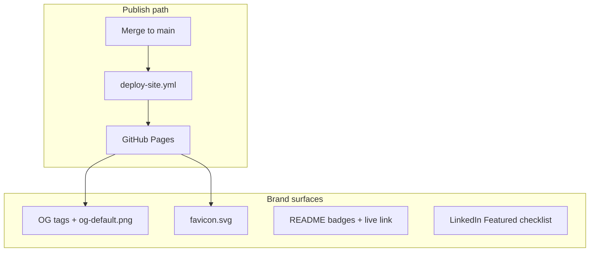
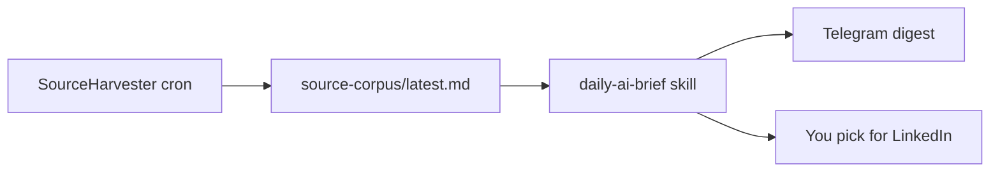

# Modern site, constitution, Week 1 ops, and daily news agent

## Current state (what you already have)

| Area | Status |
|------|--------|
| **GitHub Pages** | Astro 5 at [`site/`](site/), deployed by [`.github/workflows/deploy-site.yml`](.github/workflows/deploy-site.yml) to `https://shiva171289.github.io/agentic-ai-architecture/` |
| **Look and feel** | Single global stylesheet in [`site/src/layouts/Base.astro`](site/src/layouts/Base.astro): system font, 42rem column, no OG/favicon, placeholder Buttondown username on [`site/src/pages/index.astro`](site/src/pages/index.astro) |
| **Hermes deploy path** | Documented in [`docs/setup/week0-accounts-checklist.md`](docs/setup/week0-accounts-checklist.md) → [`hermes/setup/01-03`](hermes/setup/) → [`hermes/PILOT-RUNBOOK.md`](hermes/PILOT-RUNBOOK.md) and [`docs/roadmap/04-agent-operations.md`](docs/roadmap/04-agent-operations.md) |
| **Agent “parts”** | Hermes **skills** in [`hermes/skills/*/SKILL.md`](hermes/skills/), shared block in [`hermes/skills/_shared/ground-rules.md`](hermes/skills/_shared/ground-rules.md), **templates** in [`hermes/templates/`](hermes/templates/), **voice** in [`content/voice-guide.md`](content/voice-guide.md) |
| **Constitution / Cursor rules** | **Not present** — no `CONSTITUTION.md`, no [`.cursor/rules`](.cursor/rules), no root `AGENTS.md` |
| **ASD-STE100** | **Not referenced** anywhere in the repo |
| **Medium** | **Not in** [`docs/roadmap/02-content-strategy.md`](docs/roadmap/02-content-strategy.md) |
| **Daily AI news / Karpathy** | Weekly only: [`hermes/tools/harvest_sources.py`](hermes/tools/harvest_sources.py) + [`research-scout`](hermes/skills/research-scout/SKILL.md) (Friday) and monthly Pattern Radar — **no daily Inshorts-style digest** |

You chose **full brand**: Pages site + README + favicon/OG + LinkedIn Featured guidance.

---

## 1. Modernize GitHub Pages and brand (technical blog standard, 2026)

**Design direction:** readable long-form (65–72ch), clear hierarchy, subtle color system (light default + optional `prefers-color-scheme: dark`), card list for patterns, sticky nav with **Start Here** emphasized, accessible contrast, skip link.

**Implementation (keep Astro dependency-light — no React unless needed):**

- Split CSS into [`site/src/styles/global.css`](site/src/styles/global.css) (tokens: `--color-bg`, `--color-accent`, `--font-sans`, `--font-mono`, spacing scale).
- Refactor [`Base.astro`](site/src/layouts/Base.astro): site header/footer, nav links (Home, Start Here, Skills map, Checklist, About, RSS), `<meta property="og:*">` and Twitter card tags via props (`title`, `description`, optional `ogImage`).
- Redesign [`index.astro`](site/src/pages/index.astro): hero (title + one-line positioning + link to Acme storyline), pattern cards (week, level tag from front matter when present, date), resources grid.
- Enhance [`blog/[slug].astro`](site/src/pages/blog/[slug].astro): show `level` / `patternWeek` badges, optional table-of-contents for long posts (CSS `scroll-margin` on headings).
- Add static assets under [`site/public/`](site/public/): `favicon.svg`, default `og-default.png` (1200×630 — title + subtitle; generate once via script or simple SVG→PNG pipeline).
- Fix newsletter embed: replace `YOUR_USERNAME` with real Buttondown slug from Week 0 checklist.
- Optional quick wins: `@astrojs/sitemap` (respect `base` in [`astro.config.mjs`](site/astro.config.mjs)).

**Repo README** ([`README.md`](README.md)):

- Badge row (license, site link, Actions status).
- Hero paragraph matching site positioning.
- Prominent **Live site** link and screenshot or OG image.
- Keep table of deep links; add link to new Week 1 guide (below).

**LinkedIn Featured (deliverable, not code):** add [`docs/setup/linkedin-featured-checklist.md`](docs/setup/linkedin-featured-checklist.md) with exact assets to upload: live blog URL, GitHub repo, Start Here, skills map PDF or link, one diagram from w01 — sized for Featured tiles.

---

## 2. Can you publish on Medium?

**Yes — and it fits Year 1 reach**, with guardrails:

| Topic | Recommendation |
|-------|----------------|
| **License** | Written content is **CC BY 4.0** ([`README.md`](README.md)) — republication is allowed with attribution. |
| **SEO** | Treat **your GitHub Pages blog as canonical**. On Medium, use Medium’s **canonical URL** field pointing to `https://shiva171289.github.io/agentic-ai-architecture/blog/.../` (or import story if Medium supports it for your account). |
| **What to post** | **Post A–style** excerpts (800–1200 words) + explicit “Full pattern, code, AWS/Azure mapping on the site” CTA; avoid duplicating full weekly articles verbatim every time. |
| **When** | **7–14 days after** the Sunday blog merge (LinkedIn-first rhythm in [`02-content-strategy.md`](docs/roadmap/02-content-strategy.md) stays primary). |
| **Partner Program** | Optional; Year 1 goal is audience, not revenue ([`06-future-monetization.md`](docs/roadmap/06-future-monetization.md)). |

Add a short **Syndication** section to [`docs/roadmap/02-content-strategy.md`](docs/roadmap/02-content-strategy.md) and a Medium front-matter note in [`hermes/templates/blog.md`](hermes/templates/blog.md) (`canonicalUrl`, `mediumRepublishDate` optional).

---

## 3. Constitution + ASD-STE100 (for all future agent instructions and procedural docs)

Create a single source of truth: **[`hermes/CONSTITUTION.md`](hermes/CONSTITUTION.md)** (hub) referenced by every Hermes skill and by Cursor work in this repo.

**Sections:**

1. **Mission** — learning in public, Acme spine, grounding rules (pointer to [`00-ground-rules.md`](docs/roadmap/00-ground-rules.md)).
2. **Voice** — pointer to [`content/voice-guide.md`](content/voice-guide.md).
3. **Grounding** — corpus + [`verified-sources.json`](hermes/sources/verified-sources.json); no invented vendor facts.
4. **ASD-STE100 profile** (for agent-generated **instructions**, runbooks, checklists, Telegram digests, and “how to” sections in blogs):
   - Use **approved simple words**; avoid idioms and metaphor.
   - **One instruction per sentence**; max ~20 words where practical.
   - **Imperative** for steps (“Install the package”, not “You should install”).
   - **Active voice**; name the actor (Hermes, you, the reader).
   - Numbered steps for procedures; one topic per paragraph.
   - **Exceptions:** LinkedIn opinion posts and narrative blog intros may use voice-guide tone first; **procedure blocks** inside articles must still follow STE100.
5. **Skill hierarchy** — weekly-pack orchestrates; critic gates ADR; tier 0 vs 1 models ([`04-agent-operations.md`](docs/roadmap/04-agent-operations.md)).
6. **Git safety** — `drafts/*` only from VPS; you merge on laptop.

**Wire-up:**

- Extend [`hermes/skills/_shared/ground-rules.md`](hermes/skills/_shared/ground-rules.md): “Read `hermes/CONSTITUTION.md`; apply ASD-STE100 to all procedural output.”
- Add **[`.cursor/rules/agent-constitution.mdc`](.cursor/rules/agent-constitution.mdc)** (glob `**/*`) pointing to the same file for Cursor agents.
- Add root **[`AGENTS.md`](AGENTS.md)** — short map for humans: Constitution, Hermes skills, Cursor rules, voice guide, Week 1 runbook.

Update [`content/voice-guide.md`](content/voice-guide.md) with one section: “Procedures use ASD-STE100 (see constitution).”

---

## 4. Agent stack guide (constitution, skills, rules — what was missing)

New doc: **[`docs/setup/agent-stack.md`](docs/setup/agent-stack.md)** — the “how to set up an agent” page you asked for.

| Layer | Where it lives | Purpose |
|-------|----------------|---------|
| **Constitution** | `hermes/CONSTITUTION.md` | Non-negotiable rules + STE100 |
| **Hermes skills** | `hermes/skills/<role>/SKILL.md` | VPS/Telegram autonomous roles |
| **Templates** | `hermes/templates/` | Output shape (blog, ADR, LinkedIn) |
| **Orchestrator** | `weekly-pack` | End-to-end week pipeline |
| **Sources** | `harvest_sources.py` + allowlist | Facts for scouts |
| **Cursor rules** | `.cursor/rules/*.mdc` | IDE agent behavior on this repo |
| **Cursor skills** | Your user `~/.cursor/skills-cursor/` | Personal IDE workflows (outside repo) |
| **Plans** | `.cursor/plans/` | Ephemeral planning artifacts |
| **Secrets** | VPS `~/.hermes/.env` only | Never in git |

Include a **first-time VPS diagram** (Telegram → Hermes → OpenRouter → git `drafts/wNN` → you/Cursor → `main` → Pages).

Link from [`README.md`](README.md), [`roadmap.md`](roadmap.md), and Start Here synced content.

---

## 5. Week 1 operating guide (your step-by-step document)

New doc: **[`docs/setup/week1-operating-guide.md`](docs/setup/week1-operating-guide.md)** — day-by-day checklist (ASD-STE100 formatted), consolidating existing runbooks without duplicating every command.

| Day | Focus | Primary references |
|-----|--------|-------------------|
| **Day 1** | Week 0 accounts, private repo skeleton, protect `main` | [`week0-accounts-checklist.md`](docs/setup/week0-accounts-checklist.md) |
| **Day 2** | Hostinger VPS hardening + `hermes` user | [`01-hostinger-vps.md`](hermes/setup/01-hostinger-vps.md) |
| **Day 3** | Hermes install, OpenRouter $10 cap, skills symlink, git clone | [`02-hermes-install.md`](hermes/setup/02-hermes-install.md) |
| **Day 4** | Telegram bot, allowlist your user ID, gateway service | [`03-telegram-gateway.md`](hermes/setup/03-telegram-gateway.md) |
| **Day 5** | Harvest sources + Telegram `brief w01` / `pack w01` | [`PILOT-RUNBOOK.md`](hermes/PILOT-RUNBOOK.md) |
| **Day 6** | Cursor polish, pytest, merge to `main`, verify Actions + live site | pilot runbook §5–6 |
| **Day 7** | LinkedIn Post A/B prep, log `metrics.md`, schedule cron | [`cron.md`](hermes/cron.md), [`02-content-strategy.md`](docs/roadmap/02-content-strategy.md) |

Each day: **Goal**, **Steps** (numbered imperatives), **Done when**, **If blocked**.

**Your immediate next steps (Week 1, executive summary):**

1. Finish Week 0 table (OpenRouter limit, Telegram ID, Buttondown slug).
2. Bring VPS + Hermes + Telegram to `status` OK.
3. Run one full `pack w01` and merge after local pytest.
4. Ship first LinkedIn posts from merged `patterns/w01-augmented-llm/linkedin.md`.
5. Turn on Thursday harvest cron only after pilot cost is under ~$3 ([`PILOT-RUNBOOK.md`](hermes/PILOT-RUNBOOK.md)).

---

## 6. Daily AI news agent (Karpathy + corpus → Telegram Inshorts)

**Separate from** `weekly-pack` to control cost and cadence.

**New skill:** [`hermes/skills/daily-ai-brief/SKILL.md`](hermes/skills/daily-ai-brief/SKILL.md)

- **Inputs:** last 24–48h from `content/source-corpus/latest.md` (after harvest) + dedicated feeds.
- **Outputs:** `content/daily-brief/YYYY-MM-DD.md` + Telegram message (5–10 items).
- **Format per item (ASD-STE100):** headline (≤12 words), 2–3 sentences (≤50 words), source URL, optional **LinkedIn angle** one line.
- **Karpathy block:** always scan dedicated sources when new content exists; if none, say “No new Karpathy post in window” (do not hallucinate).

**Allowlist extension** in [`verified-sources.json`](hermes/sources/verified-sources.json) (verify URLs at implement time):

- Karpathy blog RSS (e.g. `karpathy.github.io` / GitHub releases if he publishes there).
- Karpathy YouTube channel RSS (public feed URL).
- Optional: curated AI newsletters already on allowlisted hosts (e.g. add `importai.substack.com`, `huggingface.co/blog` RSS) — **no X/Twitter API in v1** (paid/unstable); use RSS/HTML allowlist only.

**Cron:** daily 07:00 IST in [`hermes/cron.md`](hermes/cron.md) — run harvest with `--days 2` then `daily-ai-brief`.

**Telegram:** document commands in [`04-agent-operations.md`](docs/roadmap/04-agent-operations.md): `news today`, `news karpathy`.

**LinkedIn workflow:** you pick 1–2 items from the daily brief for same-day or next-day posts (do not auto-post to LinkedIn from Hermes in Year 1).

---

## 7. Suggested implementation order

1. **Week 1 operating guide + agent-stack + constitution** — unblocks you on Hermes this week without waiting on design.
2. **Constitution wired into skills + Cursor rule** — prevents drift on STE100.
3. **Site + README + OG/favicon + Buttondown fix** — public face matches quality of w01 content.
4. **Medium syndication section** — one paragraph in content strategy + template note.
5. **Daily brief skill + feeds + cron** — after Telegram pilot is stable (avoid two moving parts on Day 4).

---

## Files to add or change (summary)

| Action | Path |
|--------|------|
| Add | `hermes/CONSTITUTION.md`, `AGENTS.md`, `docs/setup/agent-stack.md`, `docs/setup/week1-operating-guide.md`, `docs/setup/linkedin-featured-checklist.md` |
| Add | `hermes/skills/daily-ai-brief/SKILL.md`, `content/daily-brief/.gitkeep` |
| Add | `.cursor/rules/agent-constitution.mdc`, `site/src/styles/global.css`, `site/public/favicon.svg`, `site/public/og-default.png` |
| Edit | `site/src/layouts/Base.astro`, `site/src/pages/index.astro`, `site/src/pages/blog/[slug].astro`, `README.md`, `content/voice-guide.md`, `hermes/skills/_shared/ground-rules.md`, `hermes/sources/verified-sources.json`, `hermes/cron.md`, `docs/roadmap/02-content-strategy.md`, `docs/roadmap/04-agent-operations.md`, `roadmap.md` |

No change to Acme code required for this pass unless you want the Week 1 guide linked from [`content/start-here.md`](content/start-here.md) (recommended one-line link after sync script).
