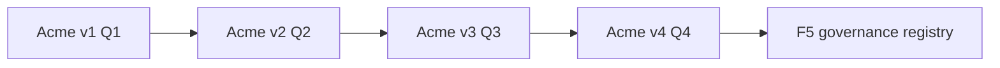

# Running use-case: Acme Support Platform

One fictional system grows across all 52 weekly patterns. Readers follow **Acme Manufacturing** from a simple FAQ assistant to a governed, multi-agent enterprise platform. Weekly pattern samples in `patterns/wNN-slug/code/` stay isolated for copy-paste learning; the **Acme stage** in `projects/acme-support/` shows the same pattern in context.

See [content/calendar.md](../../content/calendar.md) for the live schedule (Acme stage + level columns).

## Storyline and releases

Acme sells consumer hardware online. Support volume is rising; leadership wants AI assistance without skipping architecture basics.

| Release | Weeks | What ships |
|---------|-------|------------|
| **Acme v1** | w01–w13 | Single-agent support: augmentation, chains, routing, ReAct, tools, MCP, agentic RAG, memory |
| **Acme v2** | w15–w26 | Multi-agent desk: supervisor, specialists, blackboard, events, sagas, HITL, KG-RAG |
| **Acme v3** | w28–w39 | Production: guardrails, identity, MCP gateways, evals, tracing, cost, CI/CD, managed runtimes |
| **Acme v4** | w41–w46 | Back-office: procure-to-pay, reconciliation, inventory, compliance, ERP via MCP |
| **F5 (separate repo)** | w47–w52 | Agent governance registry and multi-cloud reference (not only support) |

Buffer weeks (w14, w27, w40, w52 partial) host retrospectives, **quarterly design challenges**, and budget reviews.

## Repository mechanics

- **Hub path:** `projects/acme-support/` until end of Q1 (Week 13).
- **Split target:** `shiva171289/acme-agentic-support` at **Acme v1** (W13). Later quarterly tags (`v2`, `v3`, `v4`) mark releases on the same repo.
- **Git tags:** `stage-wNN` after each weekly merge; `v1`–`v4` at quarter-end release weeks.
- **Changelog:** [projects/acme-support/STAGES.md](../../projects/acme-support/STAGES.md) — one line per week.
- **Isolated pattern code:** remains under `patterns/wNN-slug/code/` for readers who skip the storyline.

### Stage rules (Apply it to Acme)

Every weekly Acme increment must:

1. Use **synthetic data only** (fictional Acme policies, orders, tickets — no employer material).
2. **Run in mock LLM mode** without cloud keys (`uv run pytest` in `projects/acme-support/`).
3. Stay **small**: roughly 50–150 lines net change per week unless a release week consolidates docs.
4. **Build on prior stages** — no parallel rewrite; checkout `stage-w(N-1)` if unsure.
5. Include a short **Architect's notebook** in the blog (decision, rejected option, failure mode, cost hint, NFRs).

## Level ladder (reader progression)

| Level | Calendar weeks | Reader outcome |
|-------|----------------|----------------|
| **Foundation** | Q1 (w01–w13) | Can design a single support agent with RAG, tools, and memory |
| **Practitioner** | Q2 (w15–w26) | Can decompose into multi-agent flows, sagas, and human gates |
| **Production** | Q3 (w28–w39) | Can harden for security, evals, observability, and cost |
| **Architect** | Q4 (w41–w52) | Can integrate ERP/back-office and govern a fleet of agents |

Each blog post lists **prerequisites** (earlier week links).

## Week-by-week Acme stage map

| Week | Pattern slug | Acme stage (increment) |
|------|--------------|------------------------|
| w01 | augmented-llm | Keyword retrieval over synthetic policy docs + prompt contract for FAQ answers |
| w02 | prompt-chaining | Classify intent → answer with separate prompts (billing vs product) |
| w03 | routing | Route simple FAQs to mock “fast” model path vs complex to “capable” path |
| w04 | parallelization | Fan-out: retrieve policy + fetch order snippet in parallel before one answer |
| w05 | orchestrator-workers | Orchestrator delegates “lookup order” worker then merges for reply |
| w06 | evaluator-optimizer | Draft reply → critic checks policy compliance → one rewrite (includes reflection) |
| w07 | react | ReAct loop to decide when to call order lookup tool |
| w08 | plan-and-execute | Plan multi-step “replacement part” flow before executing tools |
| w09 | agent-or-workflow | **Architect lesson:** document which Acme flows stay workflow vs agent (no code spike) |
| w10 | tool-calling | Structured tool: `get_order_status(order_id)` with policy gate |
| w11 | mcp-servers | Wrap order + CRM tools as MCP-style server registry |
| w12 | agentic-rag | Upgrade retrieval: agent chooses when to search vs answer from thread |
| w13 | memory-context | Persist customer thread summary across turns; tag **v1** |
| w14 | q1-retrospective | Design challenge: “10× ticket volume” — publish your returns-flow answer |
| w15 | supervisor | Supervisor routes to billing / returns / tech specialist agents |
| w16 | hierarchical-teams | Team lead + sub-agents for “warranty dispute” subtree |
| w17 | handoff-swarm | Hand off stuck ticket to human with full context packet |
| w18 | blackboard | Shared blackboard for multi-step refund investigation |
| w19 | long-running-background-agents | Case agent pauses overnight; resumes on webhook (durable case id) |
| w20 | a2a-protocol | Specialist agents call each other via typed A2A-style messages |
| w21 | event-driven-agents | Ticket created event triggers async agent workflow |
| w22 | saga-compensation | Refund + reship saga with compensate-on-failure |
| w23 | durable-execution | Checkpoint saga steps; replay after crash |
| w24 | human-in-the-loop | Refunds above threshold require human approval |
| w25 | kg-rag | Knowledge graph links product → symptom → policy clause |
| w26 | multi-agent-reference | End-to-end reference doc + diagram; tag **v2** |
| w27 | q2-retrospective | Design challenge: multi-agent failure modes at scale |
| w28 | prompt-injection-defense | Sanitize malicious content in customer email before tools |
| w29 | least-privilege-tools | Scope tools per specialist agent role |
| w30 | agent-identity | Agent acts as service principal; audit actor on each tool call |
| w31 | mcp-gateways | Central MCP gateway with auth and rate limits |
| w32 | offline-evals | Golden set for refund/policy answers offline |
| w33 | online-evals | Production sampling + regression alerts |
| w34 | otel-tracing | Trace ID across supervisor → tools |
| w35 | model-routing-cost | Cache FAQ embeddings; tier models by ticket type |
| w36 | reliability-fallbacks | Circuit breaker on order API; degraded FAQ-only mode |
| w37 | agent-cicd | CI gate: evals + policy tests before deploy |
| w38 | managed-runtime-showdown | Compare managed runtime deployment sketch for Acme |
| w39 | finance-workflow-reference | Finance handoff from approved refunds; tag **v3** |
| w40 | q3-retrospective | Design challenge: cost vs quality under SLA |
| w41 | procure-to-pay-agent | Agent creates PO for replacement parts (fictional ERP) |
| w42 | finance-reconciliation | Reconcile refund batch against ledger export |
| w43 | inventory-planning | Suggest spare parts replenishment from ticket trends |
| w44 | compliance-audit-agent | Immutable audit trail for regulated refund decisions |
| w45 | erp-mcp-integration | ERP functions exposed via MCP (generic SAP/D365 angles) |
| w46 | agentic-erp-reference | Full back-office layer map; tag **v4** |
| w47 | governance-registry | Register all Acme agents, owners, data classes |
| w48 | policy-enforcement | Policy engine denies out-of-scope tool calls fleet-wide |
| w49 | computer-use-agents | Optional computer-use path for legacy ERP screen (stub) |
| w50 | audit-observability | Fleet-wide audit search and retention |
| w51 | multi-cloud-reference | Same Acme logical arch on AWS + Azure deployment views |
| w52 | year-retrospective | Year wrap + **F5** governance repo split checklist |

## Pattern Radar (monthly)

On the **first Friday** of each month, ResearchScout also drafts `content/radar/YYYY-MM.md`: 3–5 items from the source corpus (new vendor features, papers, OSS releases) and **where each would plug into Acme**. Publish as a short blog or LinkedIn thread; does not replace the weekly pattern.

## Quarterly design challenges

During buffer weeks, post a scenario (e.g. “Design Acme returns at 10× volume with same headcount”). Collect reader sketches via comments/DMs; your retrospective post includes a reference answer tied to patterns shipped that quarter.

## Related docs

- [01-year1-learning-plan.md](01-year1-learning-plan.md) — Acme releases replace separate flagship products for v1–v4
- [05-repo-strategy.md](05-repo-strategy.md) — split schedule for `acme-agentic-support`
- [content/ai-architect-skills-map.md](../../content/ai-architect-skills-map.md) — competency matrix
- [Start Here](/start-here/) — site entry path (primer + storyline)

## Disclaimer

Fictional Acme Manufacturing only. Learning material — see [00-ground-rules.md](00-ground-rules.md).
