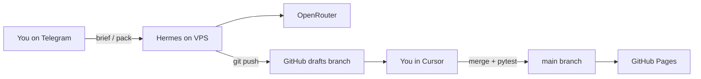

# Agent stack — constitution, skills, rules, secrets

This document explains how the **Hermes** agent team on the VPS and **Cursor** agents on your laptop fit together in the hub repo.

**Constitution:** [hermes/CONSTITUTION.md](../../hermes/CONSTITUTION.md) · **Week 1 deploy:** [week1-operating-guide.md](week1-operating-guide.md)

---

## Layers

| Layer | Location | Purpose |
|-------|----------|---------|
| **Constitution** | [hermes/CONSTITUTION.md](../../hermes/CONSTITUTION.md) | Mission, grounding, ASD-STE100, git safety |
| **Hermes skills** | `hermes/skills/<role>/SKILL.md` | Autonomous roles on the VPS |
| **Shared skill block** | [hermes/skills/_shared/ground-rules.md](../../hermes/skills/_shared/ground-rules.md) | Included in every skill prompt |
| **Templates** | [hermes/templates/](../../hermes/templates/) | Shape of blog, ADR, LinkedIn, brief |
| **Orchestrator** | [weekly-pack](../../hermes/skills/weekly-pack/SKILL.md) | End-to-end weekly pattern pipeline |
| **Source corpus** | [harvest_sources.py](../../hermes/tools/harvest_sources.py) + [verified-sources.json](../../hermes/sources/verified-sources.json) | Vendor facts for scouts |
| **Cursor rules** | [.cursor/rules/](../../.cursor/rules/) | IDE agent behavior in this repo |
| **Cursor skills** | `~/.cursor/skills-cursor/` (your machine) | Personal workflows; not in git |
| **Plans** | `.cursor/plans/` | Session plans; not canonical docs |
| **Voice** | [content/voice-guide.md](../../content/voice-guide.md) | Blog and LinkedIn tone |
| **Secrets** | VPS `~/.hermes/.env` | OpenRouter key, Telegram token |

---

## End-to-end flow (first-time VPS)



1. You send Telegram commands to Hermes on the Hostinger VPS.
2. Hermes calls OpenRouter (Tier 0/1 per [04-agent-operations.md](../roadmap/04-agent-operations.md)).
3. Hermes commits to `drafts/wNN` and pushes with the deploy key.
4. You fetch the branch on your laptop. You polish in Cursor.
5. You merge to `main`. GitHub Actions deploys the Astro site and runs pattern tests.

---

## Hermes skill roster

| Skill | Folder | Typical trigger |
|-------|--------|-----------------|
| SourceHarvester | `source-harvester` | Cron Thursday; `sources refresh` |
| ResearchScout | `research-scout` | Friday cron; `brief wNN` |
| PatternArchitect | `pattern-architect` | Inside `pack wNN` |
| ReviewerCritic | `reviewer-critic` | ADR gate |
| CloudMapper | `cloud-mapper` | AWS/Azure mapping |
| CodeBuilder | `code-builder` | Pattern + Acme stage code |
| DiagramAgent | `diagram-agent` | Mermaid diagrams |
| BlogWriter | `blog-writer` | Long-form blog draft |
| LinkedInEditor | `linkedin-editor` | Post A/B |
| GrowthAnalyst | `growth-analyst` | Weekly metrics (private repo) |
| Weekly pack | `weekly-pack` | `pack wNN` |
| Daily AI brief | `daily-ai-brief` | Cron daily; `news today` |

Install skills on the VPS:

```bash
for d in ~/work/agentic-ai-architecture/hermes/skills/*/; do
  ln -sf "$d" ~/.hermes/skills/"$(basename "$d")"
done
```

After `git pull`, symlinks pick up skill edits automatically.

---

## Cursor agents in this repo

1. Read [AGENTS.md](../../AGENTS.md) and [hermes/CONSTITUTION.md](../../hermes/CONSTITUTION.md).
2. Follow [.cursor/rules/agent-constitution.mdc](../../.cursor/rules/agent-constitution.mdc).
3. Use personal skills under `~/.cursor/skills-cursor/` for Cursor product tasks (hooks, share, etc.).

Cursor does **not** replace Hermes for scheduled harvest or Telegram packs unless you run those steps manually.

---

## Git workflow

| Actor | Branches | Identity |
|-------|----------|----------|
| Hermes (VPS) | `drafts/*` only | `Hermes (drafts)` |
| You (laptop) | `main`, feature fixes | Your personal git user |

Protect `main` in GitHub. Require pull request or merge locally after review.

---

## Secrets checklist

| Secret | Store | Never |
|--------|-------|-------|
| OpenRouter API key | `~/.hermes/.env` on VPS | Hub repo |
| Telegram bot token | Hermes gateway config on VPS | Hub repo |
| AWS/Azure keys for sandboxes | Your password manager / cloud console | Hub repo |

---

## Related setup runbooks

1. [week0-accounts-checklist.md](week0-accounts-checklist.md)
2. [hermes/setup/01-hostinger-vps.md](../../hermes/setup/01-hostinger-vps.md)
3. [hermes/setup/02-hermes-install.md](../../hermes/setup/02-hermes-install.md)
4. [hermes/setup/03-telegram-gateway.md](../../hermes/setup/03-telegram-gateway.md)
5. [hermes/PILOT-RUNBOOK.md](../../hermes/PILOT-RUNBOOK.md)
6. [hermes/cron.md](../../hermes/cron.md)
